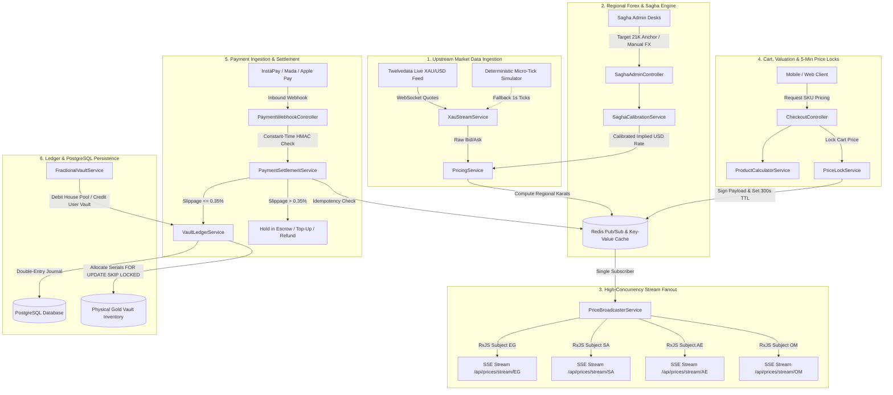
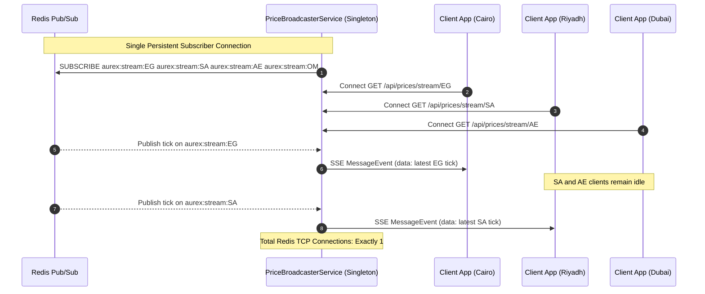
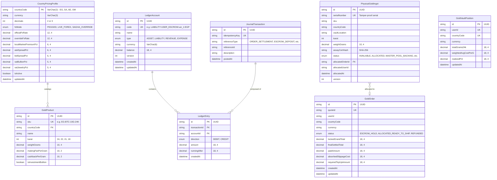
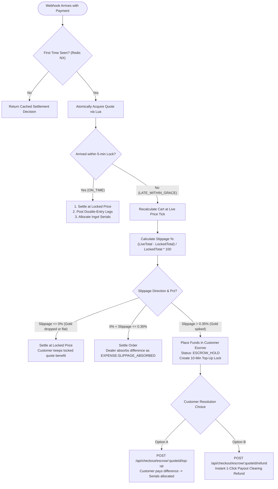
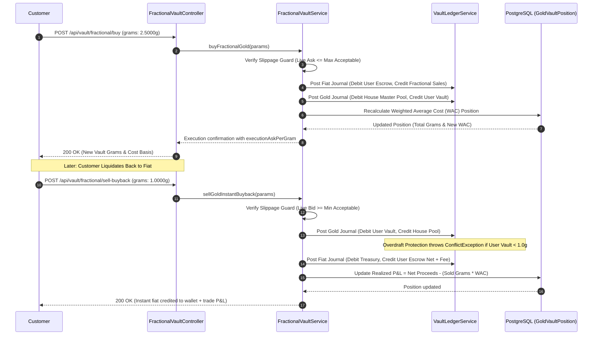
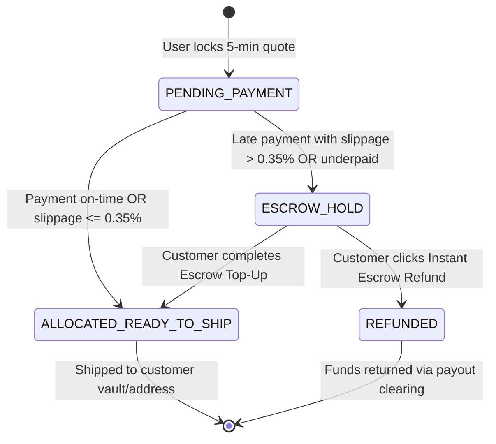
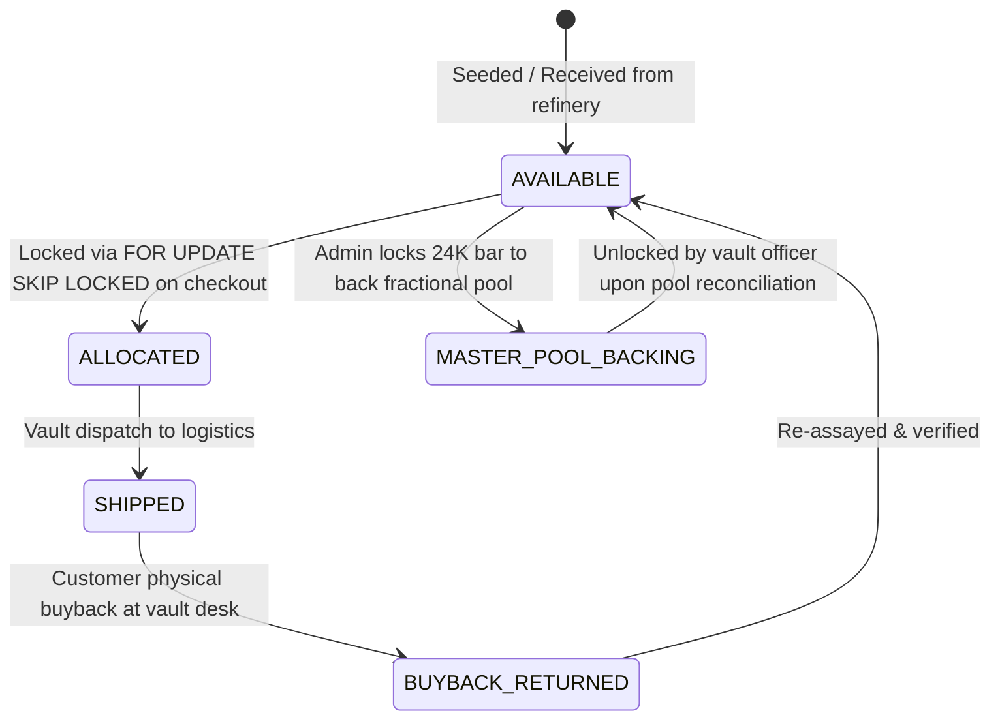

# AUREX Multi-Country Gold Engine

### Enterprise Multi-Jurisdiction Physical & Fractional Gold Trading, Settlement, & Double-Entry Accounting Platform

[](https://nestjs.com/)
[](https://www.typescriptlang.org/)
[](https://www.prisma.io/)
[](https://www.postgresql.org/)
[](https://redis.io/)
[](<>)
[](<>)

---

## Table of Contents

1. [Executive Summary](#-executive-summary)
2. [End-to-End System Architecture](#-end-to-end-system-architecture)
3. [Zero-Leak Stream Fanout Architecture](#-zero-leak-stream-fanout-architecture)
4. [Double-Entry Accounting & Ledger Topology](#-double-entry-accounting--ledger-topology)
5. [Database Entity-Relationship Model (ERD)](#-database-entity-relationship-model-erd)
6. [Asymmetric Late-Payment Settlement Engine](#-asymmetric-late-payment-settlement-engine)
7. [Fractional 24K Vault & Instant Liquidity Engine](#-fractional-24k-vault--instant-liquidity-engine)
8. [Regional Tax, VAT, & Market Calibration Mechanics](#-regional-tax-vat--market-calibration-mechanics)
9. [Finite State Machines (Order & Ingot Lifecycles)](#-finite-state-machines-order--ingot-lifecycles)
10. [Security & Cryptographic Guarantees](#-security--cryptographic-guarantees)
11. [Complete API Reference & Data Contracts](#-complete-api-reference--data-contracts)
12. [Observability, Health & Diagnostics](#-observability-health--diagnostics)
13. [Getting Started & Production Runbook](#-getting-started--production-runbook)

---

## Executive Summary

The **Aurex Multi-Country Gold Engine** is an institutional-grade backend core engineered for high-throughput, low-latency gold bullion commerce and fractional wealth accumulation across four core Middle Eastern jurisdictions:

- 🇪🇬 **Egypt (EG)**: High-volatility market anchored by the Cairo Sagha street gold benchmark, featuring localized 14% VAT on manufacturing charges (_Masna'eya_) and dynamic Sagha Dollar calibration.
- 🇸🇦 **Saudi Arabia (SA)**: Regulated GCC market operating under SAMA guidelines, featuring pegged SAR forex, 0% VAT on investment bullion (>=99% pure), and 15% VAT on ornamental jewelry.
- 🇦🇪 **United Arab Emirates (AE)**: Dubai gold hub operating under pegged AED forex, 0% VAT on qualifying investment bars, and 5% VAT on commemorative coins and jewelry.
- 🇴🇲 **Oman (OM)**: High-precision market denominated in Omani Rials with mandatory 3-decimal point precision (_Baisa_) and 5% VAT rules.

---

## End-to-End System Architecture

The following diagram illustrates the flow of market ticks, quotation requests, payment webhook settlement, and ledger postings across service boundaries:



---

## Zero-Leak Stream Fanout Architecture

In financial applications with streaming prices, creating a dedicated Redis connection for each Server-Sent Events (SSE) subscriber leads to rapid connection pool exhaustion. Aurex implements an in-memory multiplexer pattern:



---

## Double-Entry Accounting & Ledger Topology

Every balance movement in Aurex is recorded as an immutable double-entry journal transaction. Total Debits strictly equal Total Credits.

### Chart of Accounts

| Account Code Template                              | Account Type | Balance Normal | Invariant / Overdraft Rule                                |
| :------------------------------------------------- | :----------- | :------------- | :-------------------------------------------------------- |
| `ASSET:GATEWAY_CLEARING:<CURRENCY>`                | `ASSET`      | Debit (+)      | Inbound payment gateway clearing account                  |
| `ASSET:PAYOUT_CLEARING:<CURRENCY>`                 | `ASSET`      | Debit (+)      | Outbound customer refund / disbursement account           |
| `ASSET:TREASURY_GOLD_DESK:<CURRENCY>`              | `ASSET`      | Debit (+)      | Internal bullion inventory and buyback desk               |
| `ASSET:PHYSICAL_VAULT_POOL:<COUNTRY>:XAU_G`        | `ASSET`      | Debit (+)      | Physical 100g/1000g bars backing the fractional pool      |
| `LIABILITY:USER_ESCROW:<USER_ID>:<CURRENCY>`       | `LIABILITY`  | Credit (+)     | Customer unspent fiat balance. **CANNOT DROP < 0**        |
| `LIABILITY:USER_GOLD_VAULT:<USER_ID>:XAU_G`        | `LIABILITY`  | Credit (+)     | Customer fractional 24K gold balance. **CANNOT DROP < 0** |
| `LIABILITY:HOUSE_UNALLOCATED_POOL:<COUNTRY>:XAU_G` | `LIABILITY`  | Credit (+)     | Available fractional grams for sale. **CANNOT DROP < 0**  |
| `REVENUE:GOLD_SALES:<CURRENCY>`                    | `REVENUE`    | Credit (+)     | Recognized revenue from physical bullion sales            |
| `REVENUE:FRACTIONAL_GOLD_SALES:<CURRENCY>`         | `REVENUE`    | Credit (+)     | Recognized revenue from fractional 24K sales              |
| `REVENUE:BUYBACK_LIQUIDATION_FEE:<CURRENCY>`       | `REVENUE`    | Credit (+)     | 0.15% dealer fee captured upon customer liquidation       |
| `EXPENSE:SLIPPAGE_ABSORBED:<CURRENCY>`             | `EXPENSE`    | Debit (+)      | Cost absorbed by dealer on late payments (<= 0.35%)       |

### Standard T-Account Journal Examples

#### A. Standard Inbound Order Settlement (With 0.25% Dealer Absorbed Slippage)

```text
1. INBOUND DEPOSIT LEG:
   DEBIT  ASSET:GATEWAY_CLEARING:EGP               10,000.00 EGP
   CREDIT LIABILITY:USER_ESCROW:usr_42:EGP         10,000.00 EGP

2. SETTLEMENT & REVENUE SWEEP LEG:
   DEBIT  LIABILITY:USER_ESCROW:usr_42:EGP         10,000.00 EGP
   DEBIT  EXPENSE:SLIPPAGE_ABSORBED:EGP                25.00 EGP  (Dealer absorbs 0.25%)
   CREDIT REVENUE:GOLD_SALES:EGP                   10,025.00 EGP  (Total recognized revenue)
   --------------------------------------------------------------------------------------
   TOTAL DEBITS: 20,025.00 EGP  |  TOTAL CREDITS: 20,025.00 EGP  (BALANCED)
```

#### B. Fractional 24K Gold Purchase (1.0000g @ 4,450.00 EGP)

```text
1. FIAT BOOK:
   DEBIT  LIABILITY:USER_ESCROW:usr_42:EGP          4,450.00 EGP  (User fiat balance decreases)
   CREDIT REVENUE:FRACTIONAL_GOLD_SALES:EGP        4,450.00 EGP  (Aurex recognizes fiat revenue)

2. GOLD BOOK (XAU_G):
   DEBIT  LIABILITY:HOUSE_UNALLOCATED_POOL:EG:XAU_G  1.0000g       (Available pool decreases)
   CREDIT LIABILITY:USER_GOLD_VAULT:usr_42:XAU_G     1.0000g       (User gold balance increases)
   --------------------------------------------------------------------------------------
   100% Physically Backed Invariant: Backing Bar Grams >= Sum of User Vault Grams
```

---

## Database Entity-Relationship Model (ERD)



---

## Asymmetric Late-Payment Settlement Engine

When a customer initiates an instant payment (e.g. via Egyptian InstaPay or Saudi Mada), the settlement webhook may arrive after the 5-minute price lock has expired. Aurex handles this via an asymmetric slippage engine:



---

## Fractional 24K Vault & Instant Liquidity Engine

Users can accumulate fractional 24K gold with as little as 0.0100 grams, backed 100% by physical bars in the vault:



---

## Regional Tax, VAT, & Market Calibration Mechanics

### 1. Regional Tax & VAT Calculation Matrix

| Country                  | Code | Currency | Decimals | Investment Bullion (24K >=99%) | Jewelry / Coins (<99% Karat) | Regional VAT Special Rules                                           |
| :----------------------- | :--- | :------- | :------- | :----------------------------- | :--------------------------- | :------------------------------------------------------------------- |
| **Egypt**                | `EG` | `EGP`    | 2        | 0% on Metal                    | 0% on Metal                  | **14% VAT applies exclusively to the Making Charge (_Masna'eya_)**   |
| **Saudi Arabia**         | `SA` | `SAR`    | 2        | 0% VAT Exempt                  | 15% Standard VAT             | Bullion qualifying under SAMA rules is completely zero-rated         |
| **United Arab Emirates** | `AE` | `AED`    | 2        | 0% VAT Exempt                  | 5% Standard VAT              | Investment precious metals exempt under UAE Federal Tax Authority    |
| **Oman**                 | `OM` | `OMR`    | 3        | 0% VAT Exempt                  | 5% Standard VAT              | **All monetary transactions computed in 3 decimal places (_Baisa_)** |

### 2. Egypt Sagha Implied Dollar Formula

In Egypt, local gold prices decouple from official bank foreign exchange rates. The engine reverse-calculates the implied Sagha Dollar:

$$\text{Price}_{\text{24K}} = \text{Price}_{\text{21K}} \times \frac{24}{21}$$

$$\text{Implied Ounce in EGP} = \text{Price}_{\text{24K}} \times 31.1034768$$

$$\text{Implied Sagha USD/EGP} = \frac{\text{Implied Ounce in EGP}}{\text{Spot XAU/USD}}$$

### 3. Weighted Average Cost (WAC) Formula

When customers accumulate fractional grams across fluctuating market ticks:

$$\text{WAC}_{\text{new}} = \frac{(\text{Grams}_{\text{held}} \times \text{WAC}_{\text{old}}) + (\text{Grams}_{\text{bought}} \times P_{\text{ask}})}{\text{Grams}_{\text{held}} + \text{Grams}_{\text{bought}}}$$

Upon sale, realized profit or loss is calculated:

$$\text{Realized P&L} = \text{Net Payout} - (\text{Grams}_{\text{sold}} \times \text{WAC})$$

---

## Finite State Machines (Order & Ingot Lifecycles)

### 1. Order Settlement Lifecycle (`GoldOrder`)



### 2. Physical Ingot Inventory Lifecycle (`PhysicalGoldIngot`)



---

## Security & Cryptographic Guarantees

1. **Constant-Time Timing-Safe HMAC Verification**:
   - Webhook HMAC-SHA256 signatures and Admin API Keys are checked using `crypto.timingSafeEqual` with byte buffers. This guarantees immunity to side-channel timing attacks.
2. **Deterministic Account Locking**:
   - Ledger accounts are sorted alphabetically by account code before execution. PostgreSQL acquires row-level locks via `SELECT ... FOR UPDATE` in this strict order, eliminating deadlocks under high concurrency.
3. **Overdraft Protection**:
   - Negative liability balance checks are enforced at the database transaction layer. Attempting to deduct more escrow or gold grams than a user possesses throws a `409 ConflictException` and rolls back the transaction.
4. **Tamper-Proof Ingot Assay Hashes**:
   - Every physical bar records an immutable SHA-256 hash derived from its serial number and assay certificate.

---

## Complete API Reference & Data Contracts

### 1. Market Data & Pricing

#### `GET /api/prices/latest/:country`

Fetch the latest sub-second pricing snapshot for a specific country.

- **Parameters**: `country` (`EG`, `SA`, `AE`, `OM`)
- **Response `200 OK`**:

```json
{
  "country": "EG",
  "currency": "EGP",
  "timestamp": 1731301200000,
  "spotUsd": { "bid": 2745.3, "ask": 2745.6 },
  "fxRate": 53.99,
  "karats": {
    "24K": { "ask": 4768.12, "bid": 4720.45 },
    "22K": { "ask": 4370.78, "bid": 4327.08 },
    "21K": { "ask": 4172.11, "bid": 4130.39 },
    "18K": { "ask": 3576.09, "bid": 3540.34 }
  },
  "units": {
    "goldPound8g21k": { "ask": 33376.88, "bid": 33043.12 },
    "tola24k": { "ask": 55614.45, "bid": 55058.2 },
    "ounce24k": { "ask": 148255.1, "bid": 146771.55 }
  }
}
```

#### `GET /api/prices/stream/:country` (SSE)

High-concurrency Server-Sent Events stream for real-time price feeds.

---

### 2. Checkout & Price Locks

#### `GET /api/checkout/sku/:sku?qty=1`

Get transparent price breakdown for a product.

- **Response `200 OK`**:

```json
{
  "sku": "EG-BTC-10G-24K",
  "name": "BTC 10g 24K Gold Ingot (Sealed)",
  "countryCode": "EG",
  "currency": "EGP",
  "karat": "24K",
  "weightGrams": 10,
  "quantity": 1,
  "unitBreakdown": {
    "rawGoldPricePerGram": 4768.12,
    "makingFeePerGram": 68.0,
    "vatAmountPerUnit": 95.2,
    "unitTotalAsk": 48456.4,
    "unitResaleBidSealed": 47484.5,
    "unitResaleBidOpened": 47314.5
  },
  "lineTotalAsk": 48456.4
}
```

#### `POST /api/checkout/lock`

Lock live prices for 5 minutes (300 seconds).

- **Request Body**:

```json
{
  "userId": "usr_99182",
  "countryCode": "EG",
  "items": [{ "sku": "EG-BTC-10G-24K", "quantity": 1 }]
}
```

- **Response `201 Created`**:

```json
{
  "quoteId": "q_7a2f1c8e9b0d1e2f3a4b",
  "userId": "usr_99182",
  "countryCode": "EG",
  "currency": "EGP",
  "grandTotal": 48456.4,
  "lockedAt": 1731301200000,
  "expiresAt": 1731301500000,
  "ttlSeconds": 300,
  "status": "ACTIVE",
  "signature": "d3b07384d113edec49eaa6238ad5ff00..."
}
```

#### `POST /api/checkout/confirm`

Confirm and settle order directly from pre-funded wallet balance.

- **Request Body**:

```json
{
  "quoteId": "q_7a2f1c8e9b0d1e2f3a4b",
  "userId": "usr_99182",
  "paymentReference": "WALLET_DIRECT_PAY"
}
```

---

### 3. Payment Webhooks

#### `POST /api/webhooks/payments/egypt-ipn`

Webhook receiver for Egyptian instant payment networks (InstaPay / Vodafone Cash).

- **Headers**: `x-aurex-signature: <hex-hmac>`
- **Request Body**:

```json
{
  "rrn": "410294819201",
  "quoteId": "q_7a2f1c8e9b0d1e2f3a4b",
  "userId": "usr_99182",
  "method": "EG_INSTAPAY",
  "amountEgp": 48456.4,
  "senderAddress": "arafa@instapay",
  "settledTimestampMs": 1731301260000
}
```

#### `POST /api/webhooks/payments/gcc-gateway`

Unified card and Apple Pay webhook for Saudi Arabia, UAE, and Oman.

- **Headers**: `x-aurex-signature: <hex-hmac>`

---

### 4. Escrow & Late-Payment Resolution

#### `POST /api/checkout/escrow/:quoteId/top-up`

Complete settlement by paying the spiked price difference.

- **Request Body**:

```json
{
  "userId": "usr_99182",
  "topUpTxId": "TOPUP_99182741",
  "topUpPaidAmount": 145.2,
  "items": [{ "sku": "EG-BTC-10G-24K", "quantity": 1 }]
}
```

#### `POST /api/checkout/escrow/:quoteId/refund`

Trigger instant 1-click refund for an order held in escrow.

- **Request Body**: `{ "userId": "usr_99182" }`

#### `GET /api/checkout/escrow/:quoteId/audit`

Retrieve the full double-entry audit trail, including all ledger entries and allocated bar serial numbers.

---

### 5. Fractional 24K Vault

#### `POST /api/vault/fractional/buy`

Buy fractional 24K gold using fiat wallet balance.

- **Request Body**:

```json
{
  "userId": "usr_99182",
  "countryCode": "EG",
  "gramsToBuy": 2.5,
  "maxAcceptableAskPerGram": 4775.0,
  "idempotencyKey": "buy_step_1092"
}
```

#### `POST /api/vault/fractional/sell-buyback`

Instant buyback: sell fractional 24K gold back to Aurex at live Bid.

- **Request Body**:

```json
{
  "userId": "usr_99182",
  "countryCode": "EG",
  "gramsToSell": 1.0,
  "minAcceptableBidPerGram": 4710.0,
  "idempotencyKey": "sell_step_1093"
}
```

#### `GET /api/vault/fractional/portfolio/:userId?country=EG`

Retrieve live portfolio valuation, weighted average cost basis, and unrealized/realized P&L.

---

### 6. Administration & Market Calibration (Protected)

_All admin endpoints require header `x-admin-key: <ADMIN_API_KEY>`._

#### `POST /api/admin/sagha/anchor-21k`

Anchor Egyptian pricing to street benchmark.

- **Request Body**:

```json
{
  "target21kEgp": 6275.0,
  "askSpreadPct": 0.004,
  "bidSpreadPct": 0.006,
  "adminName": "DESK_CHIEF"
}
```

#### `POST /api/admin/sagha/lock-fx`

Directly lock the implied Sagha Dollar forex rate.

- **Request Body**: `{ "saghaUsdEgp": 54.20, "adminName": "DESK_CHIEF" }`

#### `POST /api/admin/sagha/auto`

Resume automated background Sagha benchmark calibration.

#### `POST /api/vault/fractional/pool/load-bar`

Lock a physical 24K kilobar into the master fractional backing pool.

- **Request Body**: `{ "serialNumber": "BTC-EG-24K-1000G-001" }`

---

## Observability, Health & Diagnostics

### Readiness Health Probe

`GET /api/health` reports status across infrastructure dependencies:

```json
{
  "status": "HEALTHY",
  "uptimeSeconds": 14280,
  "timestamp": "2026-11-11T07:45:00.000Z",
  "checks": {
    "database": { "status": "UP" },
    "redis": { "status": "UP" },
    "marketFeed": {
      "status": "UP",
      "details": "Latest tick age: 1.2s"
    }
  }
}
```

---

## Getting Started & Production Runbook

### 1. Requirements

- Node.js 20+
- PostgreSQL 15+
- Redis 7+

### 2. Environment Setup

```bash
cp .env.example .env
```

Ensure `.env` contains valid credentials for `DATABASE_URL`, `REDIS_URL`, `ADMIN_API_KEY`, `PAYMENT_WEBHOOK_SECRET`, and `QUOTE_HMAC_SECRET`.

### 3. Build & Verify

```bash
# 1. Install dependencies
npm install

# 2. Generate Prisma Client
npx prisma generate

# 3. Run ESLint code-quality verification (0 errors, 0 warnings)
npm run lint

# 4. Run automated unit test suite (27 tests)
npm test

# 5. Build production bundle
npm run build

# 6. Start production server
npm run start:prod
```

### 4. Running the Multi-Scenario E2E Integration Suite

To verify end-to-end price updates, quote locking, InstaPay webhook settlement, and Sagha market spikes:

```bash
npm run test:e2e:aurex
```

---

## License

Proprietary & Confidential. All rights reserved by Aurex Gold Technologies.
